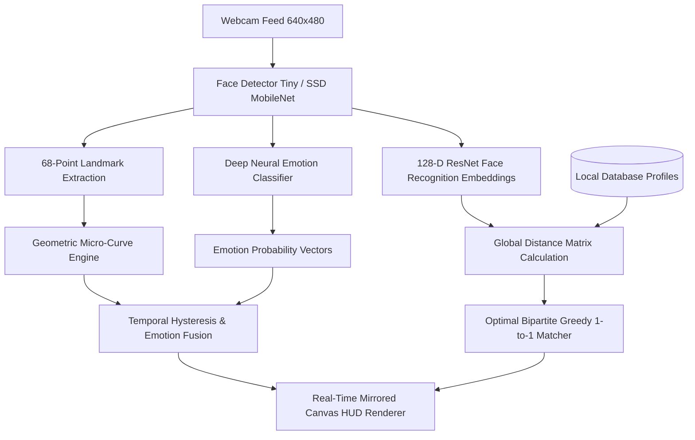

# AI SENTRY PRO - Facial Recognition & Micro-Expression Engine

[](https://github.com/revanth1029/AI-Face-Recognition-Sentry)
[](https://vercel.com/new/clone?repository-url=https://github.com/revanth1029/AI-Face-Recognition-Sentry)
[](https://js.tensorflow.org/)
[](https://github.com/vladmandic/face-api)

A real-time, browser-based Artificial Intelligence computer vision suite designed for **simultaneous multi-person facial recognition** and **hyper-responsive micro-expression analysis**.

Built on client-side WebGL / TensorFlow.js, the system operates with zero cloud transmission, zero image uploads, and sub-30ms latency directly on standard laptop hardware.

---

## 🌟 Key Highlights

* **Multi-Person Bipartite 1-to-1 Matching Engine:** Solves the classic multi-face identity swapping problem using optimal bipartite Euclidean matching. Prevents false positive match propagation and guarantees that no two faces can ever be assigned the same identity in the same frame.
* **Hyper-Responsive Micro-Expression Sensor:** Fuses a deep neural emotion network with 68 facial landmark geometric micro-curves (mouth corner elevation, eyebrow inter-ocular distance, asymmetric smirk detection) and temporal hysteresis.
* **Cyberpunk Clean Glassmorphic UI:** Features clean rounded bounding boxes with glowing neon shaders, dynamic text-measured HUD badges without text clipping or overflow, and multi-face telemetry counters.
* **Zero-Cloud Local Biometric Vault:** Face vector descriptors (128-dimensional Float32 embeddings) are stored locally in browser `localStorage`. No raw photos or camera feeds are ever transmitted, ensuring privacy and GDPR compliance.
* **Interactive Multi-Face Enrollment:** When multiple people appear in front of the camera, users can simply click on any face in the live video viewfinder or tap the dynamic face selector buttons to target the exact person for biometric enrollment.
* **Configurable Multi-Face Strictness:** Switch between **Ultra-Strict (0.40)**, **Standard (0.44)**, and **Permissive (0.50)** Euclidean distance thresholds to match varying lighting conditions.
* **Full Database Management:** Live profile grid with visual avatar initials, individual profile deletion, complete database wipe with confirmation, and one-click JSON database export/import.
* **One-Click GitHub Sync:** Includes `push.bat` and `auto_sync.py` for continuous, automated commits and pushes to the project's GitHub repository.

---

## 🔬 System Architecture



### Multi-Face Optimal Matching Mathematical Formulation
For $N$ detected faces and $M$ registered database profiles, the pairwise Euclidean distance matrix $D \in \mathbb{R}^{N \times M}$ is defined as:

$$D_{i, j} = \left\| \mathbf{f}_i - \mathbf{p}_j \right\|_2 = \sqrt{\sum_{k=1}^{128} (f_{i, k} - p_{j, k})^2}$$

All pairs $(i, j)$ satisfying $D_{i, j} \le \tau_{\text{threshold}}$ are sorted in ascending order. Greedy assignment enforces mutual exclusivity:
$$\text{Assign}(i) = \arg\min_{j \in \text{Unassigned}} D_{i, j}$$

Any detection not matched to an unassigned profile below the threshold $\tau_{\text{threshold}}$ is flagged as `SUSPECT UNKNOWN`.

---

## 🚀 Quick Start Guide

### 1. Launch the Server
In PowerShell from the project folder:
```powershell
.\serve.ps1
```
Or double-click `start.bat`. This automatically spins up a local HTTP server on `http://localhost:8000/` and launches Google Chrome.

### 2. Start Monitoring
1. Click **START MONITORING** to initialize the webcam stream.
2. Select your laptop's integrated camera from the **Camera Source** dropdown if multiple devices are attached.

### 3. Enroll Faces
* **Single Person:** Enter a name into **Target Profile Name** and click **ENROLL**.
* **Multiple People in Camera:** Click directly on the target person's face box in the camera feed, or click their button (`[ Face 1 (Left) ]` / `[ Face 2 (Right) ]`) and click **ENROLL**.

### 4. Push Updates to GitHub
Double-click `push.bat` or run:
```powershell
.\push.bat "Your commit message"
```
Or execute:
```powershell
python auto_sync.py
```

---

## 📁 Repository Structure

* `index.html`: Main HUD application layout and glassmorphic control panels.
* `app.js`: Real-time inference loop, 1-to-1 bipartite matching, and micro-expression fusion.
* `style.css`: Responsive cyberpunk styling, glassmorphism, and responsive bounds.
* `serve.ps1`: Native PowerShell static HTTP server with Chrome auto-launch.
* `serve.py`: Multi-threaded Python HTTP static server with CORS.
* `start.bat`: Quick launch batch script.
* `push.bat`: One-click Git staging, commit, and push utility to GitHub.
* `auto_sync.py`: Automated Python GitHub synchronization script.

---

## 💻 Tech Stack

* **Frontend:** Vanilla ES6+ JavaScript, HTML5 Canvas, CSS Glassmorphism
* **Computer Vision & ML:** TensorFlow.js, face-api.js (vladmandic fork)
* **Models:** Tiny Face Detector, SSD MobileNet V1, 68 Landmark Net, 128-d Face Recognition Net, Emotion & Demographics Networks
* **Version Control:** Git & GitHub (`revanth1029/AI-Face-Recognition-Sentry`)

---
Created by Revanth S for AI / Computer Vision Project Submission.
